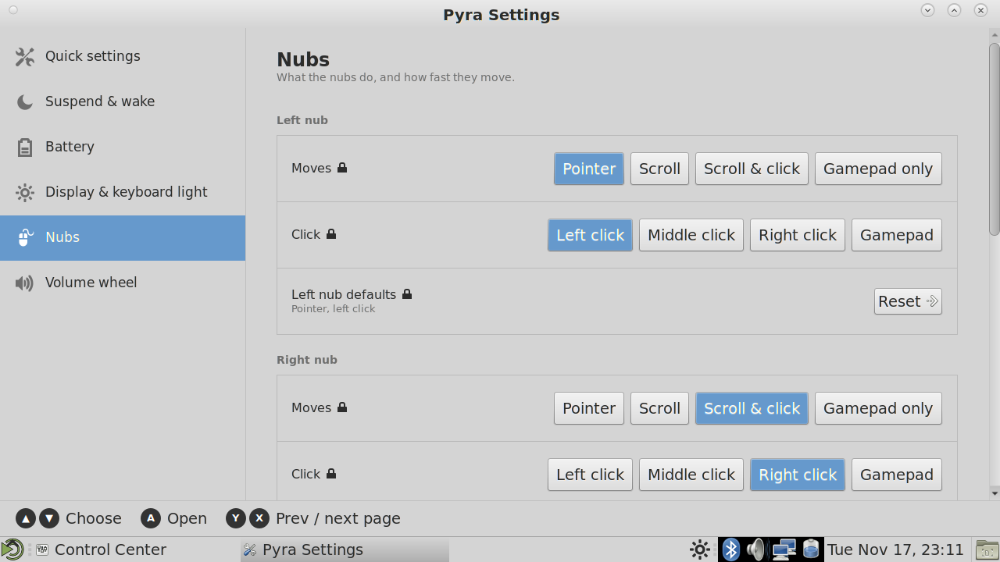

# Pyra Settings

A small GTK 3 settings app for the DragonBox Pyra, covering which buttons wake it from suspend, what
the nubs do, how the volume wheel maps to speaker and headphone volume, how far the screen dims when idle, the
keyboard light level at login, and how fast the CPU may run. It runs on the
[dragonbox-pyra](https://github.com/daniel-mcdonough/dragonbox-pyra) image (Debian trixie, MATE, X11) and ships as an
`Architecture: all` `.deb`.



## Motivation

- Out of the box, the shoulder buttons can wake the Pyra which can accidentally be pressed during transport.

  - johnicboom's forum thread
[Suspend investigation, with a reboot bonus](https://pyra-handheld.com/boards/threads/suspend-investigation-with-a-reboot-bonus.100153/)
gave me a head start on the button wake work.

- Other Pyra-specific settings had no convenient, central place to change them. They lived in config files,
  sysfs files that reset every boot, or values hard-coded in a systemd unit:
  - `/etc/pyrainput.cfg` for the nubs
  - `/etc/pyra_volumed.conf` for the wheel
  - `/etc/default/pyra-thermal` for a top CPU speed the thermal daemon keeps

## Why not just use MATE

MATE's Control Center panels don't take plugin pages. Adding wake buttons to `mate-power-preferences` means patching
the Debian package and maintaining a fork.

This separate app's `.desktop` file has `Categories=Settings;HardwareSettings;`, so Pyra Settings shows up in MATE
Control Center's Hardware group.
It pulls in only the MATE setting that interacts with Pyra-only ones (the lid action) and leaves everything else
in MATE. Both apps write the same gsettings keys, so a change in one shows up in the other without any syncing. There's no graceful way around this toe-stepping.

## Approach

- The GUI is Python 3 and GTK 3 through PyGObject, which are already on the image and follows the GTK theme.
- The GUI runs as the user and root-only writes go through a `pkexec` helper with a fixed command set
  and hard-coded paths.
- Privileged actions use polkit via `auth_admin_keep` so you type the password once and it holds for a few minutes.
- Wake settings live in one INI file, `/etc/pyra-settings/pyra-settings.conf`, which a oneshot unit reapplies at
  boot.
- The whole UI is drivable from the Pyra's controls: d-pad to move, A to activate, B to go back, X/Y to change page.
  Touch and the nubs work as well.

## Requirements

- A Pyra running the dragonbox-pyra image (Debian trixie, MATE, X11, 1280x720).
- `python3`, `python3-gi`, `gir1.2-gtk-3.0`, `pkexec`, `polkitd`, `alsa-utils`, `pulseaudio-utils`, which should be on the image already.
- `pyra-backlight` 0.4 or later for the Display & keyboard light page. Without it the page says it isn't installed
  and shows no settings.
- The pyra-hacks fork package, `0.38+pyra3` or later, for the Volume wheel page. Stock pyra-hacks 0.38's
  `pyra_volumed` doesn't read a config file at all. The Performance page needs `0.38+pyra5` or later, whose
  thermal daemon reads the CPU ceiling; with an older one the page says so.
- A kernel with dragonbox-pyra patch 0053, which adds `wakeup_keys` and `wakeup_switches` to the gpio-keys
  devices. Every dragonbox-pyra image has it. Without it the wake settings show as unreadable.

## Install

Download the `.deb` from [Releases](https://github.com/daniel-mcdonough/pyra-settings/releases) on the Pyra and
install it:

```sh
sudo apt install ./pyra-settings_<version>_all.deb
```

pyra-backlight and the pyra-hacks fork are Recommends, not Depends: apt installs them along with it only if it can
find them, so install their `.deb`s first if you want those pages.

From a checkout, after a build:

```sh
scripts/install-on-pyra.sh pyra@<address>
```

This copies the newest `.deb` from `dist/` to the Pyra and runs `sudo apt-get install -y --reinstall` on it.

To check the install:

```sh
systemctl status pyra-settings-apply   # with no config yet: "start condition unmet", which is fine
pkaction --action-id org.pyra.settings.wake --verbose
```

Then open it from System > Preferences > Hardware, or from MATE Control Center.

## Build

The package is arch-independent.

```sh
# In a clean debian:trixie container (needs docker). Leaves the .deb in dist/
scripts/build-deb.sh

# Or directly on a Debian machine
dpkg-buildpackage -us -uc -b
```

`build-deb.sh` also runs `desktop-file-validate` and lintian. If your local `debian:trixie` image happens to be
`linux/arm/v7` it runs under qemu, which is slow but works.

Pushing a `v<version>` tag that matches the top entry of `debian/changelog` runs the tests, builds the `.deb` on
GitHub Actions and publishes it as a release (`.github/workflows/release.yml`).

## Configuration

You shouldn't need to edit anything by hand, but these are the files involved:

| File | Owner | Written by |
|---|---|---|
| `/etc/pyra-settings/pyra-settings.conf` | root | The helper. Reapplied at boot by `pyra-settings-apply.service` |
| `/etc/pyrainput.cfg` | root | The helper (`set-nubs`), then `systemctl reload pyrainput` |
| `/etc/pyra_volumed.conf` | root | The helper (`set-volume`), then a restart of `pyra_volumed` |
| `/etc/default/pyra-thermal` | root | The helper (`set-cpu-max`); the thermal daemon reads it within 2 s. Deleted for "No limit" |
| `~/.config/pyra-backlight.conf` | user | The GUI, then `systemctl --user reload pyra-idle-dim` |
| `org.mate.power-manager` keys | user | The GUI, through gsettings |

The wake config looks like this:

```ini
[wake]
game-buttons = 102,103,104,105,106,107,108,109,272,273
lid = on
```

A missing key leaves the kernel default alone, so an empty file does nothing. "No game buttons" is stored as
`game-buttons = none`. Comments in this file don't survive a save (Python's `configparser` drops them).

## How it works

```
 user session (pyra)                                     root
 ┌────────────────────────┐   pkexec    ┌──────────────────────────────┐
 │ pyra-settings (GTK 3)  │────────────▶│ pyra-settings-helper         │
 │ reads sysfs, never     │  polkit:    │ fixed commands, known device │
 │ writes it              │  auth_admin │ names, codes checked against │
 └──────────┬─────────────┘  _keep      │ `keys`, refuses power button │
            │ gsettings                 └───────┬──────────────┬───────┘
            ▼                                   │ writes now   │ saves
 ┌────────────────────────┐                     ▼              ▼
 │ org.mate.power-manager │◀── MATE   ┌──────────────┐ ┌──────────────────────┐
 │ (lid, sleep, battery)  │   panels  │ sysfs wake   │ │ /etc/pyra-settings/  │
 └────────────────────────┘           │ files        │ │ pyra-settings.conf   │
                                      └──────────────┘ └──────────▲───────────┘
                         pyra-settings-apply.service (boot) ──────┘ helper apply
```

- The GUI reads the sysfs wake files directly (they're world-readable) to show live state, and writes gsettings
  for per-user settings.
- The helper (`/usr/libexec/pyra-settings/pyra-settings-helper`) accepts `set-wake`, `set-nubs`, `set-volume`,
  `set-cpu-max` and `apply`. It maps known device names to hard-coded sysfs paths, checks every button code against that device's
  `keys` file, writes sysfs first and then replaces the config atomically. If the sysfs write fails, the config is
  left alone.
- The helper runs with `python3 -I` (isolated mode) on top of pkexec's own environment scrub. Its paths are module
  constants. Only the test suite overrides them, by import, never through an env var or argument.
- The GUI calls the helper asynchronously, so the window keeps drawing while mate-polkit asks for the password. If
  you cancel, the GUI re-reads sysfs and the control flips back on its own.
- 0053 is detected by whether `wakeup_keys` exists, never by kernel version.

The full design and the reasoning behind each decision are in [`docs/design.md`](docs/design.md). The UI layout is
in [`docs/ui.md`](docs/ui.md).

## Limitations and real-world notes

- **The power button always wakes the Pyra.** The helper refuses to turn it off, not just the UI. With the power
  button and every game button off, only the RTC alarm could wake the machine.
- **Wake changes take effect at the next suspend.** Nothing happens at the moment of the write. The status line
  says so.
- **`disabled_keys` is not a wake control.** It looks like one, but it disables the button's interrupt, so the
  button stops working while the machine is awake too. The app never touches it.
- **No idle sleep setting.** MATE only starts the sleep timer after the session goes idle
  (`org.mate.session idle-delay`, 30 minutes by default).
  Idle sleep stays in MATE's Power Management panel.
- **Nub profiles override the Nubs page.** If something ran `pyrainputctl overload`, the page shows a notice.

## Troubleshooting

**Volume wheel page shows a note instead of controls.** The page checks that `pyra_volumed.service` runs
`/usr/bin/pyra_volumed` and that the binary reads `/etc/pyra_volumed.conf`. The
dragonbox-pyra image's fix 12 installs its own build with hard-coded values, via a systemd drop-in, and that build
ignores `/etc/pyra_volumed.conf`. Install the pyra-hacks fork package and undo fix 12
(`device/pyra-volumed/install.sh --undo` in the dragonbox-pyra checkout). Details in
[`docs/volume-wheel.md`](docs/volume-wheel.md).

**Performance page shows a note instead of controls.** The page looks for the ceiling reader
(`pyraReadCeiling`) in `/usr/share/pyra/scripts/pyra-thermal.sh`, which pyra-hacks `0.38+pyra5` and later have.
The vendor's 0.38, and a card prepared with dragonbox-pyra's `--no-settings`, don't. Install the fork package and
restart the app.

**Lid action rows are greyed out with "MATE power settings not found".** The `org.mate.power-manager`
schema isn't installed. On the image it always is; on a PC it usually isn't (see "Running on a PC").

**MATE's Power Management panel shows empty combo boxes.** You probably opened it from ssh. Outside the seat
session logind answers `challenge` instead of `yes` for suspend and power-off, and the panel only lists actions
that answer `yes`. Open it from the desktop.

**Wake settings rows are greyed out.** The app couldn't read the sysfs wake files. The status line says which.

**A button I turned off still wakes the Pyra, or the reverse.** Check that `power/wakeup` on
`/sys/devices/platform/pyra-game-buttons` is `enabled`. It gates the whole device: with it `disabled`, nothing
on the device wakes the machine, whatever `wakeup_keys` says. `/sys/power/pm_wakeup_irq` after a resume tells you
what actually woke it. Ignore `power/wakeup_count` on the gpio-keys devices, it stays 0 either way.

## Development

Tests run anywhere with Python 3, against a fake sysfs tree:

```sh
python3 -m unittest discover -s tests
```

### Running on a PC

The GUI runs on a desktop PC at 1280x720 against fake stand-ins. You need a fake sysfs tree, the gsettings schemas
the app uses, and a fake helper, since `pkexec` would otherwise go for the real one:

```sh
glib-compile-schemas <schemas>     # after copying tests/schemas/*.xml into it
python3 tests/fakesysfs.py <sys> [--no-0053]   # --no-0053: the unreadable wake rows
cd src && GSETTINGS_SCHEMA_DIR=<schemas> GSETTINGS_BACKEND=keyfile XDG_CONFIG_HOME=<cfg> \
  PYRA_SETTINGS_SYSFS=<sys> PYRA_SETTINGS_HELPER="python3 ../tests/fakehelper.py <sys> <conf>" \
  python3 -m pyra_settings
```

The env vars for the Nubs, Volume wheel and Display pages, and how to run it headless under Xvfb, are in
[`docs/testing.md`](docs/testing.md).

## License

GPL-2.0-or-later (`COPYING`). The volume wheel page's test sound, `data/sounds/volume-test.ogg`, is CC0. See
`debian/copyright`.
